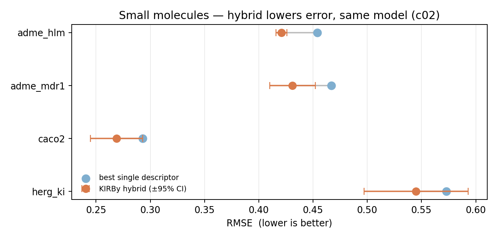
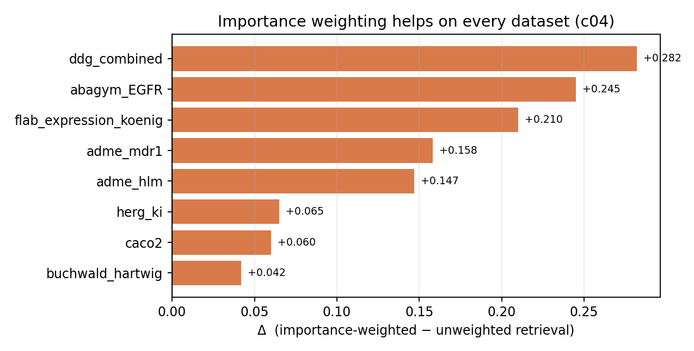

# OPIG talk — slide content (generated from `prelimResults`)

_Source: `/Users/apunt/Downloads/prelimResults` — every number parsed from the report, not retyped. Regenerate: `python tests/analysis/opig_slide_figures.py`._

**Big picture (one line):** the hybrid helps most exactly where no single representation already dominates and there is enough data / diversity to draw from — it wins cleanly on small molecules and most antibody properties, wins *biggest* when labels are scarce, and fails *predictably* when one compact representation already holds the signal (HER2, abcov_kd).

---

## Slide 1 — Small molecules: hybrid beats the best single descriptor (same model)  · experiment c02

_Metric: RMSE (lower is better). Small molecule → 95% CI shown._

dataset	model	best descriptor	base	hybrid	95% CI	Δ	verdict
adme_hlm	svm	pdv	0.454	0.421	±0.005	+0.033	WIN*
adme_mdr1	svm	smited	0.467	0.431	±0.021	+0.035	WIN*
caco2	svm	pdv	0.293	0.269	±0.024	+0.024	WIN
herg_ki	svm	molformer	0.573	0.545	±0.048	+0.028	WIN

_Say:_ "Same model, same folds — swap the single descriptor for the hybrid and the error drops. On adme_hlm the interval is tight enough that the baseline sits outside it." (qm9 was not in this run.)

---

## Slide 2 — Antibodies: it works, cleanly  · experiment c02

_Metric: Spearman ρ (higher is better). No CIs (antibody)._

dataset	model	best rep	base ρ	hybrid ρ	Δ	verdict
flab_expression_koenig	lightgbm	esm3	0.681	0.772	+0.091	WIN*
ddg_combined	ridge	esm2_wt_delta	0.293	0.401	+0.107	WIN
flab_pk_jain_heprt	ridge	prot_t5	0.735	0.795	+0.060	WIN*
flab_thermo_jain	ridge	ablang2	0.447	0.548	+0.101	WIN
flab_thermo_tresanco	ridge	saprot_cdr	0.679	0.706	+0.027	WIN

_Say:_ "The clean win. Hero is flab_expression_koenig — lightgbm on esm3, 0.681 → 0.772 ρ, a big jump from an already-strong baseline — and it repeats across expression, PK and thermostability."

---

## Slide 3 — When & why it works: EGFR **vs** HER2 (centerpiece)  · c01 / c02 / c05 / c11 / c08

_Same task (antibody binding), two targets, opposite outcomes. Each row is a labelled experiment — this is not an aggregate._

ingredient	abagym_EGFR (wins)	abagym_HER2 (stalls)
reps to draw from (c01)	26	13
best rep / effective rank (c01)	saprot / 259	mutation_features / 24
core claim Δ, same model (c02)	0.324→0.358 (+0.034)	0.453→0.361 (-0.092)
with more data (c05)	-0.040@329 → +0.035@659 (grows)	-0.092@146 → -0.092@146 (1pt)
dump all reps together, PCA-concat (c11)	concat 0.317; hybrid 0.338 (+0.015)	concat 0.151; hybrid 0.358 (-0.094)
calibration error (c08)	0.041	0.147

_Say:_ "Identical task. EGFR has many rich representations to mix and enough data — the hybrid finds signal none hold alone and its edge *grows* as data arrives. HER2 has one compact mutation vector, n is stuck, PCA-concat collapses it — nothing to combine, so the hybrid can't help. That's the rule for the whole method in one pair.

---

## Slide 4 — Ginkgo developability panel  · experiment c02 (+ HIC in the retrieval space)

_Metric: Spearman ρ. One assay per row; honest ties/losses shown._

assay	model	best rep	base ρ	hybrid ρ	Δ	verdict
acsins	ridge	igt5	0.560	0.602	+0.042	WIN
aggregation	mlp	(any)	0.163	0.235	+0.072	BEST-ANY
colloidal	ridge	prot_t5	0.417	0.413	-0.004	tie
heparin	ridge	prot_t5	0.711	0.754	+0.043	WIN
hic	ridge	esm2_concat	0.582	0.589	+0.008	tie
pr_cho	ridge	prot_t5	0.506	0.507	+0.001	tie
purity	lightgbm	esm2_midlayers	0.228	0.173	-0.055	LOSS
titer	ridge	saprot	0.399	0.427	+0.028	WIN
tm2	ridge	ablang2	0.119	0.220	+0.101	WIN

_HIC callout:_ on **accuracy** HIC is flat (c02 0.582→0.589, +0.008). But in the **retrieval / similarity space** it is the biggest lift of the panel (s02 +0.053) and it wins retrieval (s13 retr-win = True). _Say:_ "tm2 for the accuracy story, HIC for the retrieval story — do not sell HIC as accuracy."

---

## Slide 5 — The blueprint's importances are real signal  · experiment c04 (importance-weighted retrieval)

_This is the standout secondary result (it replaces the placeholder "c13" — c13 forward-compatibility produced no results this run). Each bar is one dataset; the quantity is the SAME within-dataset improvement (Δ = weighted − unweighted kNN)._

dataset	importance method	Δ (weighted − unweighted)
ddg_combined	lightgbm_gain	+0.282
flab_expression_koenig	treeshap	+0.210
abagym_EGFR	lightgbm_gain	+0.245
adme_hlm	lightgbm_gain	+0.147
adme_mdr1	lightgbm_gain	+0.158
caco2	lightgbm_gain	+0.060
herg_ki	treeshap	+0.065
buchwald_hartwig	treeshap	+0.042

_Say:_ "Weight the retrieval by the hybrid's per-feature importances and it helps on every dataset — biggest on ddg_combined. The importances the blueprint is built on carry information; they are not decoration."

---

## Slide 6 — Other domains

### Genomic — hybrid wins *and* compresses  · c02 (metric: AUROC)

dataset	model	best rep	base AUROC	hybrid AUROC	Δ	verdict
nt_promoter_tata	lightgbm	kmer5	0.661	0.710	+0.049	WIN*
gb_human_enhancers_cohn	lightgbm	grover_dna	0.480	0.506	+0.026	WIN*

_nt_promoter_tata wins while cutting dimension (1024 → 500)._

### Reaction — a small-data method  · c05 (metric: RMSE, +Δ = better)

dataset	model	n (small)	Δ @ small n	n (large)	Δ @ large n	trend
buchwald_hartwig	rf	395	+1.176	3955	+0.077	shrinks

_Say:_ "With ~395 reactions the hybrid slashes error (+1.176 RMSE); by ~3955 the single rep has caught up. KIRBy buys you the most exactly when labels are expensive."

---

## Slide 7 — One honest failure (written, no table)  · abcov_kd

> **abcov_kd** (antibody binding Kd) is the clean failure — and it fails *for a reason*. The best single representation, abroberta, already scores 0.488. Build the hybrid on it and it drops to 0.428 (-0.060, c02). Concatenate everything (PCA-concat 0.387) and it is also worse. Give it more data and it gets *worse* (-0.060 at the largest n, c05). When one representation already holds the signal, selecting and blending can only dilute it — the same mechanism as HER2, shown not hidden.

---

### Honesty notes

- Forward-compatibility (c13) and noise-robustness (c10) produced no usable numbers this run — do not claim them.

- Nothing above is averaged across datasets; every figure/table is a single experiment on your chosen datasets.
