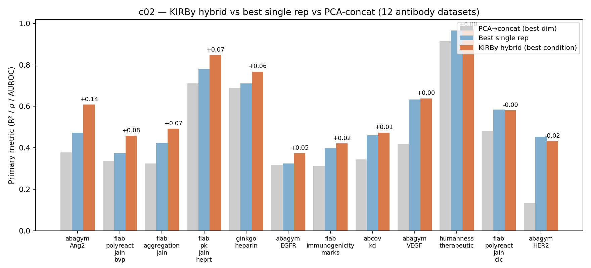
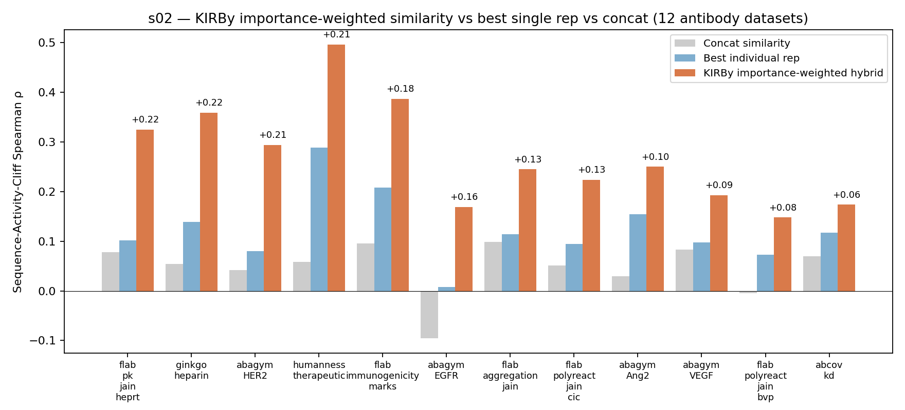

# Preliminary results — 2026-05-13

## Cohort

- 12 antibody datasets complete (11 regression, 1 classification)
- 28 datasets partial, 24 not started
- Metrics:
  - Regression: R² (5-fold CV)
  - Classification: accuracy (5-fold CV)
  - Similarity space: sequence-activity-cliff Spearman ρ

## Result 1a: c02 regression — R² (11 datasets)

KIRBy hybrid vs best single rep vs PCA→concat baseline.

| Dataset | Best single | PCA-concat | KIRBy hybrid | Δ R² |
|---|---|---|---|---|
| abagym_Ang2 | 0.474 | 0.378 | 0.609 | +0.135 |
| flab_polyreact_jain_bvp | 0.374 | 0.338 | 0.458 | +0.084 |
| flab_aggregation_jain | 0.425 | 0.324 | 0.492 | +0.067 |
| flab_pk_jain_heprt | 0.782 | 0.711 | 0.848 | +0.066 |
| ginkgo_heparin | 0.711 | 0.690 | 0.768 | +0.057 |
| abagym_EGFR | 0.324 | 0.318 | 0.374 | +0.050 |
| flab_immunogenicity_marks | 0.399 | 0.312 | 0.421 | +0.022 |
| abcov_kd | 0.460 | 0.344 | 0.474 | +0.014 |
| abagym_VEGF | 0.633 | 0.420 | 0.638 | +0.005 |
| flab_polyreact_jain_cic | 0.585 | 0.480 | 0.581 | −0.004 |
| abagym_HER2 | 0.453 | 0.135 | 0.433 | −0.020 |

- Hybrid > single: 9/11
- PCA-concat < single: 11/11
- Median Δ R² = +0.050; max Δ R² = +0.135

## Result 1b: c02 classification — accuracy (1 dataset)

| Dataset | Best single | PCA-concat | KIRBy hybrid | Δ accuracy |
|---|---|---|---|---|
| humanness_therapeutic | 0.966 | 0.914 | 0.970 | +0.004 |

- tz_her2_binary still in precompute regeneration; will join this table when caches finalise.

**Implications**
- Targeted feature selection across reps beats both single-rep and PCA-concat baselines on the regression cohort. PCA-concat losing on 11/11 rules out "concat would have worked too."
- The `top_tier_only` condition (search restricted to top-3 reps per dataset) wins on 6/12 — best results come from informed restriction, not exhaustive search.
- For the 3 augmented datasets, `capped` augmentation wins — augmentation requires a budget limit.

## Result 2: s02 — sequence-activity-cliff Spearman ρ (12 datasets, regression + classification together since metric is on rep space, not task)

Importance-weighted hybrid vs best single rep vs concat-similarity.

| Dataset | Best individual ρ | Concat ρ | KIRBy weighted ρ | Δ ρ |
|---|---|---|---|---|
| ginkgo_heparin | 0.138 | 0.054 | 0.359 | +0.221 |
| flab_pk_jain_heprt | 0.101 | 0.078 | 0.325 | +0.224 |
| abagym_HER2 | 0.080 | 0.042 | 0.294 | +0.214 |
| humanness_therapeutic | 0.289 | 0.058 | 0.496 | +0.207 |
| flab_immunogenicity_marks | 0.208 | 0.095 | 0.387 | +0.179 |
| abagym_EGFR | 0.007 | −0.095 | 0.169 | +0.162 |
| flab_aggregation_jain | 0.114 | 0.099 | 0.245 | +0.131 |
| flab_polyreact_jain_cic | 0.095 | 0.051 | 0.223 | +0.128 |
| abagym_Ang2 | 0.155 | 0.030 | 0.250 | +0.095 |
| abagym_VEGF | 0.098 | 0.083 | 0.192 | +0.094 |
| flab_polyreact_jain_bvp | 0.073 | −0.005 | 0.148 | +0.075 |
| abcov_kd | 0.117 | 0.069 | 0.173 | +0.056 |

- Weighted > individual: 12/12
- Concat < individual: 11/12
- Median Δ ρ = +0.146; max Δ ρ = +0.224

**Implications**
- Importance-weighted similarity is the strongest single result in the batch. Effect size (~+0.15 ρ) is roughly 3× the median Δ R² in c02.
- The improvement is independent of downstream model variance — this is pure rep-space geometry, so cleaner than c02.
- The hybrid wins even on datasets where no individual rep is statistically significant (EGFR, polyreact_bvp). Combining weak reps via importance weighting produces a usable similarity metric where no single rep gives one.

## Where c02 fails

Two regression losses (HER2, polyreact_cic) and two flat results (VEGF, humanness on its respective metric). The best single rep in each case:

| Dataset | Task | Metric | Best single rep | Dim | Note |
|---|---|---|---|---|---|
| abagym_HER2 | regression | R² | mutation_features | 48 | Specialised to mutation count |
| flab_polyreact_jain_cic | regression | R² | prot_t5 | 1024 | PLM saturates at R² 0.59 |
| abagym_VEGF | regression | R² | aac | 40 | AAC captures signal at 40D |
| humanness_therapeutic | classification | accuracy | antiberty_cdr | 512 | Already at 0.97 ceiling |

Pattern: hybrid does not help when a single low-dim rep already dominates.

**Implications**
- Failure mode is predictable from c01 (rep characterization): when one rep has a clear performance gap over the others, the hybrid only adds noise.
- This gives KIRBy a known scope: most useful when no single rep dominates. We can describe this as a feature, not a bug, in the paper.

## c11a — strict dim-matched check, regression — R² (8 datasets)

Hybrid forced to match best_single's dimension.

| Dataset | best_single | hybrid | Δ R² |
|---|---|---|---|
| abagym_Ang2 | 0.380 | 0.497 | +0.117 |
| flab_polyreact_jain_bvp | 0.374 | 0.396 | +0.022 |
| abagym_EGFR | 0.322 | 0.338 | +0.015 |
| flab_immunogenicity_marks | 0.359 | 0.362 | +0.003 |
| abagym_VEGF | 0.634 | 0.633 | 0.000 |
| flab_polyreact_jain_cic | 0.585 | 0.527 | −0.058 |
| abcov_kd | 0.484 | 0.391 | −0.093 |
| abagym_HER2 | 0.453 | 0.231 | −0.222 |

- Hybrid > single: 4/8 regression
- Median Δ R² = +0.002

## c11b — strict dim-matched check, classification — accuracy (1 dataset)

| Dataset | best_single | hybrid | Δ accuracy |
|---|---|---|---|
| humanness_therapeutic | 0.914 | 0.922 | +0.007 |

**Implications**
- The c02 result depends on the hybrid being allowed to choose its own dimension. Forcing it to match the best single rep's dimension cuts the regression win rate from 9/11 to 4/8.
- Losing datasets are the same in c02 and c11 — failure mode is dataset-property-driven, not condition-driven.
- For the paper: c02 is the headline; c11 is the constraint to report in the discussion.

## s01 — per-rep similarity ranking, Spearman ρ (13 datasets)

Best rep and number of statistically significant reps (permutation p<0.05). SAC ρ is the same metric across all datasets regardless of task type.

| Dataset | Best rep | ρ | Significant reps |
|---|---|---|---|
| humanness_therapeutic | igt5 | 0.289 | 15 / 26 |
| flab_immunogenicity_marks | antiberty_cdr | 0.208 | 17 / 27 |
| abagym_Ang2 | structural | 0.155 | 7 / 24 |
| ginkgo_heparin | prot_t5 | 0.138 | 4 / 27 |
| tz_her2_binary | mutation_features | 0.124 | 19 / 29 |
| abcov_kd | blosum | 0.117 | 11 / 27 |
| flab_aggregation_jain | prot_t5_cdr | 0.114 | 10 / 23 |
| flab_pk_jain_heprt | esm2_concat | 0.101 | 9 / 20 |
| abagym_VEGF | aac | 0.098 | 16 / 24 |
| flab_polyreact_jain_cic | esm2_early | 0.095 | 5 / 21 |
| abagym_HER2 | esm2_layer24 | 0.080 | 3 / 13 |
| flab_polyreact_jain_bvp | paratope | 0.073 | 0 / 23 |
| abagym_EGFR | structural | 0.007 | 0 / 26 |

- 2 datasets (polyreact_bvp, EGFR) have no significant reps individually — cliff structure is weak.
- Best rep varies across rep families (PLM, sequence, mutation, structural). No single rep dominates.

**Implications**
- Best-rep heterogeneity justifies the rep-agnostic design of KIRBy. No universal default.
- The two datasets with zero significant individual reps (polyreact_bvp, EGFR) are the ones where s02 still recovers a usable signal — strongest evidence for the value of hybrid weighting.

## s05a — kNN prediction, regression — R² (10 datasets)

| Dataset | Best single rep | KIRBy hybrid | Δ R² |
|---|---|---|---|
| flab_pk_jain_heprt | 0.520 | 0.720 | +0.200 |
| flab_polyreact_jain_cic | 0.363 | 0.508 | +0.145 |
| ginkgo_heparin | 0.579 | 0.706 | +0.127 |
| flab_polyreact_jain_bvp | 0.304 | 0.369 | +0.065 |
| abcov_kd | 0.399 | 0.453 | +0.054 |
| abagym_VEGF | 0.509 | 0.543 | +0.034 |
| abagym_Ang2 | 0.391 | 0.384 | −0.007 |
| abagym_EGFR | 0.326 | 0.305 | −0.021 |
| flab_immunogenicity_marks | 0.396 | 0.367 | −0.029 |
| abagym_HER2 | 0.332 | 0.281 | −0.051 |

- Hybrid > single: 6/10 regression
- Median Δ R² = +0.044

## s05b — kNN prediction, classification — accuracy (1 dataset)

| Dataset | Best single rep | KIRBy hybrid | Δ accuracy |
|---|---|---|---|
| humanness_therapeutic | 0.903 | 0.906 | +0.003 |

**Implications**
- Confirms the c02 / c11 pattern in a separate similarity-space test using kNN as the prediction mechanism.
- Losing datasets (HER2, EGFR) recur — single-rep dominance is the consistent failure mode across complexity-space (c02, c11) and similarity-space (s05) evaluations.

## s13 — clustering and retrieval (9 datasets)

Metrics are rep-space (clustering coherence, retrieval@k) so task-agnostic.

| Dataset | Hybrid wins clustering | Hybrid wins retrieval |
|---|---|---|
| abagym_HER2 | ✓ | ✓ |
| humanness_therapeutic | ✓ | ✓ |
| abagym_Ang2 | ✗ | ✓ |
| abcov_kd | ✗ | ✓ |
| flab_immunogenicity_marks | ✗ | ✓ |
| flab_polyreact_jain_bvp | ✗ | ✓ |
| flab_polyreact_jain_cic | ✗ | ✓ |
| abagym_EGFR | ✗ | ✗ |
| abagym_VEGF | ✗ | ✗ |

- Clustering coherence: hybrid wins 2/9
- Retrieval@k: hybrid wins 7/9

**Implications**
- The hybrid space is better for nearest-neighbour retrieval (finding similar antibodies) than for explicit cluster formation.
- Plausible reason: importance-weighted hybrid concentrates information along task-relevant directions, sharpening local neighbourhoods but blurring global structure.

## c13 — forward compatibility, win rate (unitless, 7 datasets)

Adding new representations to the hybrid pool. Win rate = fraction of new-rep insertions that improve the hybrid score.

| Dataset | Task | Win rate (E vs B) |
|---|---|---|
| flab_polyreact_jain_cic | regression | 0.79 |
| abagym_Ang2 | regression | 0.67 |
| flab_immunogenicity_marks | regression | 0.60 |
| flab_polyreact_jain_bvp | regression | 0.58 |
| abagym_VEGF | regression | 0.53 |
| abagym_HER2 | regression | 0.43 |
| abcov_kd | regression | 0.33 |

- Mean: 0.56
- Median: 0.58

**Implications**
- Mean win rate just above 0.5: adding new representations to the hybrid is on average a slight improvement but not reliable.
- 7 datasets is too few to call this a confirmed trend. Needs the molecular and TCGA cohorts to make a defensible claim about forward compatibility.

## Broken / blocked

| Experiment | Coverage | Issue |
|---|---|---|
| c10 noise robustness | 9 datasets | `noiseInject` not installed; every JSON contains error |
| c21 single-rep augmentation | 4 datasets | augmentation never applied; `kept_augmentations = []`, `n_improved=0` |
| c17, c18, c19, c22 | 4/13 each | coverage too low for trend analysis |
| s04, s11 | skipped on antibody | molecular-only experiments |

## Pipeline status

- Done: 13 datasets (12 usable, tz_her2_binary still regenerating precompute cache)
- Partial: 28
- Missing: 24
- Most recent new cache: 2026-05-06 (7 days ago); current running jobs at 1–5 days elapsed, haven't yet completed any new condition.
- Expected completion: ~7 more days (longest jobs at 5/7 day SLURM cap)

## Next steps

1. Fix `noiseInject` install on server (unblocks c10)
2. Trace c21 augmentation no-op
3. Wait for molecular cohort (logd, qm9, adme_*, herg, kiba, bindingdb_kd, reactions) before claiming domain generality
